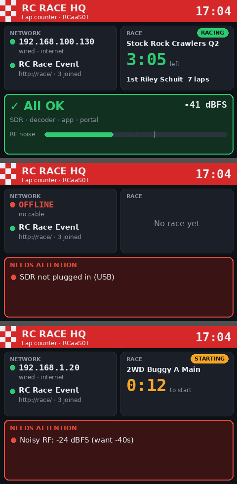

# RCRaceHQ-LapCounter-Install

One bash script that turns a Raspberry Pi 4 + RTL-SDR into an [RC Race HQ](https://www.rcracehq.com)
lap counter: the OpenStint decoder, the event Wi-Fi with its captive portal,
and the lap counter app.

The app (lapd + web UI) lives in
[RCRaceHQ-LapCounter-App](https://github.com/SturgeonTechnologies/RCRaceHQ-LapCounter-App)
and ships as a public container image, `ghcr.io/sturgeontechnologies/rcracehq-lapcounter`.
The optional RF front-end board is in
[RCRaceHQ-LapCounter-HAT](https://github.com/SturgeonTechnologies/RCRaceHQ-LapCounter-HAT).

The lap counter works on its own at the track. Event sync, uploads and the
shared transponder library need an RC Race HQ club to pair with
(Settings → Link on the Pi).

## Quick install (one command, on the Pi)

Image the Pi with **Raspberry Pi OS Lite (64-bit, Trixie)**, the recommended
OS. Ubuntu 24.04+ arm64 works too, but the first install takes longer (OpenStint
is built from source) and it has more moving parts (netplan, A/B boot). Then plug in Ethernet and the RTL-SDR, then log in as your normal user and run:

```bash
curl -fsSL https://www.rcracehq.com/lapcounter/install.sh | sudo bash
```

That copy is published from `main` after CI passes, pinned to that commit (see
[Publishing](#publishing-the-installer)). Straight from GitHub works too:
`curl -fsSL https://raw.githubusercontent.com/SturgeonTechnologies/RCRaceHQ-LapCounter-Install/main/install.sh | sudo bash`.

Options go after `bash -s --`:

```bash
# no event Wi-Fi, a specific build
curl -fsSL https://www.rcracehq.com/lapcounter/install.sh \
  | sudo bash -s -- --no-ap sha-1a2b3c4
```

| Option | Default | What it does |
|---|---|---|
| `TAG` (first plain argument) or `--tag TAG` | `latest` | Image build: `latest`, `sha-1a2b3c4`, `1a2b3c4` or `v1.2.3`. `latest` is resolved to its exact build when you install, so the Pi doesn't change until you re-run. |
| `--no-ap` | event Wi-Fi on | Don't turn `wlan0` into the event Wi-Fi. The app is still at `http://<hostname>.local/` on the wired side. |
| `--hostname NAME` | unchanged | Rename the Pi (and its `.local` name). |
| `--ssid NAME` | `RC Race Event` | Event Wi-Fi name. |
| `--passphrase PASS` | open | Event Wi-Fi password (8-63 characters). |
| `--country CC` | `US` | Wi-Fi country code. |
| `--no-screen` | status screen on | Leave the console (tty1) as a login prompt instead of the status screen. |
| `--lcd MODEL` | left as is | Set up a small SPI LCD on the GPIO header: `waveshare35a` (Waveshare / SpotPear 3.5" RPi LCD (A), incl. V3). `none` removes one set up earlier. Reboot once afterwards. See [Small LCD](#small-lcd). |
| `--lcd-rotate DEG` | `270` | LCD rotation: `0`, `90`, `180` or `270`. |

`install.sh` is plain bash. Re-run it to update or change options; finished
steps are skipped. Prefer to read it first? `curl -fsSLO …/install.sh`, read
it, then `sudo bash install.sh`. Full log: `/var/log/lapcounter-install.log`.

On Ubuntu the installer builds OpenStint from a pinned upstream commit, so the
first run takes about 5-10 minutes on a Pi 4.

After it finishes: open `http://<hostname>.local/` from the wired side, or join
the **RC Race Event** Wi-Fi and open `http://race/`. On the Pi,
`journalctl -u openstint -f` shows decoder `S` lines every second.

## Status screen

Any screen on the Pi's console (HDMI, or a small SPI LCD once its overlay is
set up) shows a status page that refreshes every 2 seconds:

- **Wired:** the `eth0` address and whether there's internet, or `OFFLINE`
- **Wi-Fi:** the event Wi-Fi name, `http://race/`, and how many devices joined
- **Race:** the heat on track (starting / racing / time left / leader), else
  the last one
- **Problems** in red: SDR not plugged in, decoder stopped or silent, noisy
  RF (noise floor above -30 dBFS), app or portal not answering, Wi-Fi down

On a colour screen it draws a dashboard: a header with the clock, Network and
Race cards (the race clock in big digits, coloured by phase), and a bottom
panel that is green with an RF noise meter when all is well, or red with the
problems listed. It's laid out for a 480x320 LCD and scaled to bigger screens.
Without a framebuffer, or with `STATUS_MODE=text` in the unit, it shows the
same information as coloured text.



It replaces the login prompt on tty1; press Alt+F2 for a login. Logs:
`journalctl -u lapcounter-status`.

### Small LCD

A 3.5" SPI LCD on the GPIO header makes the Pi show its status with no monitor:

```bash
curl -fsSL https://www.rcracehq.com/lapcounter/install.sh | sudo bash -s -- --lcd waveshare35a
sudo reboot
```

| Model | Screens | Overlay |
|---|---|---|
| `waveshare35a` | Waveshare 3.5" RPi LCD (A), SpotPear 3.5" RPi LCD (A) V3, other ILI9486 + XPT2046 "3.5 inch (A)" clones | `waveshare35a` |

What `--lcd` does, on both Raspberry Pi OS and Ubuntu:

- Downloads the overlay from a pinned Waveshare commit and checks its sha256
  (Raspberry Pi dropped `waveshare35a` from its firmware; Ubuntu never shipped it).
- Copies it into every overlays folder on the boot partition: `overlays/` on
  Raspberry Pi OS, `current/` and `new/overlays/` on Ubuntu's A/B boot.
- Adds a kernel/initramfs hook (`zzz-lapcounter-lcd`) that copies it back after
  updates, which can rewrite those folders.
- Adds `dtparam=spi=on` and the overlay line in its own marked `[all]` block at
  the end of `config.txt`, and comments out any other 3.5" LCD overlay line
  (`piscreen`, `tft35a`, an older `waveshare35a`). The original is saved once as
  `config.txt.lapcounter-bak`.
- The status screen then draws on the LCD. It picks the LCD's framebuffer over
  HDMI's (on Raspberry Pi OS the LCD is usually `fb1`), waiting up to 30 s at
  boot for its driver.

Don't run the vendor's `LCD-show` script: it rewrites `config.txt` and turns
off the graphics driver. If the screen stays **white** after a reboot, the
overlay didn't load: check `cat /sys/class/graphics/fb*/name` shows `fb_ili9486`
and that the board sits on pins 1-26 without being shifted a row.

Pins: the LCD uses SPI0 (both chip selects), GPIO24 and 25, and GPIO17 for touch.
GPIO22 stays free for the RF board's relay. The burst-detector HAT's BURST
line is also GPIO17, so it can't share a Pi with this LCD.

To add another screen later: add a model to `lcd_profile()` in `install.sh`
(overlay name, pinned URL, sha256).

## Hardware

Parts list, loop wiring and an ASCII schematic: [docs/hardware.md](docs/hardware.md).

## What's in this repo

| Path | What it is |
|---|---|
| `install.sh` | The installer |
| `files/race-portal` | Port 80 captive portal / proxy to the app (installed to `/usr/local/sbin`) |
| `files/openstint-learn` | Transponder learning helper (installed to `/usr/local/bin`) |
| `files/lapcounter-status` | Console / LCD status screen (installed to `/usr/local/sbin`) |
| `tests/` | pytest for the two helpers |
| `docs/hardware.md` | Parts list and loop wiring |

## What runs on a finished Pi

| Component | How | Port | Data |
|---|---|---|---|
| OpenStint decoder | `openstint.service` | ZeroMQ PUB :5556 | `/var/lib/openstint/*.rc4` |
| lapd | container `lapcounter-lapd-1` | reads :5556 | `/var/lib/lapcounter/lapcounter.db` |
| web | container `lapcounter-web-1` (gunicorn) | 127.0.0.1:8080 (Pi only; use :80) | same DB |
| Event hotspot | NetworkManager `race-hotspot`, `race-portal-firewall.service` | — | — |
| Captive portal | `race-portal.service` | :80 | serves the app at `http://race/` and `http://<pi>.local/` |
| DHCP/DNS | `dnsmasq` (`/etc/dnsmasq.d/race-dns.conf`) | 53, 67 on `wlan0` | |

## OpenStint

[OpenStint](https://github.com/zsellera/openstint) is a separate program by
its own authors under GPL-3.0. The installer installs it from upstream (or builds it from source on Ubuntu); none
of its code is in this repo.

## Tests

```bash
python3 -m pip install --user pytest pyzmq
python3 -m pytest tests -q
shellcheck install.sh
```

## License

Source-available under [FSL-1.1-ALv2](LICENSE) (each version becomes Apache-2.0
two years after its release). Plain-language summary: [LICENSING.md](LICENSING.md).
"RC Race HQ" is a trademark of Sturgeon Technologies LLC.

## Publishing the installer

`.github/workflows/publish.yml` runs after CI passes on `main`. It:

1. Pins `INSTALL_REF` in `install.sh` to that commit, so the helper files it
   downloads (portal, `openstint-learn`) always match the script.
2. Uploads `lapcounter/install.sh` and `lapcounter/install.sh.sha256` to the RC
   Race HQ prod site bucket (5-minute cache).
3. Invalidates `/lapcounter/*`, waits, then downloads the public URL and checks
   the checksum.

AWS access is the `rcracehq-lapcounter-publish` OIDC role
(`infrastructure/lapcounter-publish-oidc.yml` in RCRaceHQ). It can only write
`lapcounter/*` and invalidate that distribution. The job runs in the
`lapcounter-publish` Environment (main branch only), whose variables are
`AWS_ROLE_ARN`, `SITE_BUCKET` and `DISTRIBUTION_ID`.

Check a download by hand:

```bash
curl -fsSLO https://www.rcracehq.com/lapcounter/install.sh
curl -fsSL https://www.rcracehq.com/lapcounter/install.sh.sha256 | sha256sum -c -
```
